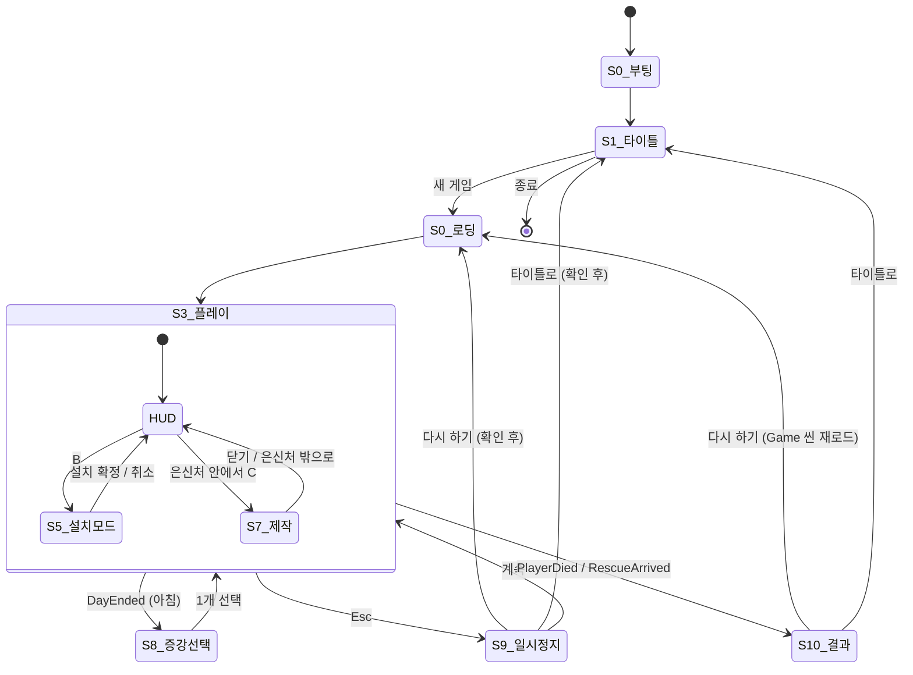

# UI Plan — Whiteout (가제)

**상태:** 확정 (지영 결정 2026-11-13, D1~D12 모두 추천안). 배치·크기·색 같은 시각 값은 *(provisional)*: 첫 플레이 후 조정한다.
상위 문서: `design/game-brief.md` · 게임 규칙: `design/quick-specs/core-rules.md` · 아이템: `design/quick-specs/items.md`
HUD 구현 값: `docs/architecture/tech-decisions.md` 22번(날씨·기온 글자), 23번(허들 게이지), 24번(UI 기술·문구)

표시 규칙:
- **(D#)** §12 지영 결정으로 확정된 곳. 관련 규칙은 core-rules·items·tech-decisions에 반영했다.
- **[가정]** 아직 정하지 않은 세부 표현(색·연출·문구 등). 구현할 때 임시값으로 두고 플레이 후 조정한다.
  게임 규칙에 영향이 있는 [가정]은 구현 전에 지영에게 확인받는다.

---

## 1. 원칙

1. **환경이 주적이므로 HUD의 1순위는 '지금 얼마나 버틸 수 있나'다.** 체온·허기·체력과 그 변화 방향을 가장 먼저 보이게 한다.
2. **화면을 가리지 않는다.** 탑다운 카메라가 플레이어 주변 약 12m만 보여 주므로(tech-decisions 22번) HUD는 네 모서리에만 둔다.
   화면 가운데는 비운다.
3. **세계에 붙는 정보는 세계에 둔다.** 모닥불 연료, 채집 진행, 상호작용 키 같은 정보는 해당 오브젝트 위에 띄운다(월드 UI).
4. **경고는 색만으로 전하지 않는다.** 색 + 아이콘/깜빡임 + 소리 중 두 가지 이상으로 전한다(색약 대응).
5. **정지하는 화면과 정지하지 않는 화면을 명확히 나눈다.** 정지는 증강 선택과 Esc 일시정지뿐이다(core-rules §1, D7). 나머지는 §3 표에 따른다.
6. **입력은 키보드+마우스 기준이다** (tech-decisions 5번). 게임패드는 MVP 이후에 입력 매핑만 추가하므로(D11),
   모든 화면을 '포커스 이동 + 확인/취소'만으로도 조작할 수 있게 설계해 둔다(마우스 전용 동작을 만들지 않는다).
7. **UI 문구는 데이터로 둔다** (D9). 한국어만 쓰지만 코드에 문구를 직접 쓰지 않는다.
8. **폰트는 Noto Sans KR** (지영 확정 2026-11-13). TextMeshPro 폰트 에셋으로 만들어 모든 UI 글자에 쓴다(tech-decisions 24번).
   큰 기온 숫자도 같은 폰트(굵게)를 쓴다.
9. **텍스트는 최대한 덜어내고 아이콘·시각 표현을 우선한다** (지영 결정 2026-11-13). 글자는 숫자·이름처럼 꼭 필요한 곳에만 쓰고,
   상태·종류·경고는 아이콘, 색, 막대, 움직임으로 먼저 전한다. 새 화면을 만들 때 글자 줄을 먼저 놓지 않는다.
10. **마우스로도 할 수 있게 한다** (지영 결정 2026-11-13). 줍기 같은 상호작용과 설치는 마우스 클릭으로 할 수 있다(§8·§9).
    E 등 키 조작은 그대로 남긴다. 원칙 6의 '마우스 전용 동작을 만들지 않는다'는 유지하되, 커서 위치 설치(§9)는 예외이고
    게임패드를 넣을 때(MVP 이후, D11) 대체 조작을 정한다.

---

## 2. 화면 목록

| ID | 화면 | 종류 | MVP 스토리 | 비고 |
|---|---|---|---|---|
| S0 | 부팅·로딩 | 전체 화면 | 009 | 최소: 페이드만 (D1). Bootstrap → Game 씬 로드 사이 (tech-decisions 12번) |
| S1 | 타이틀 | 전체 화면 | 009 | 최소 타이틀: 새 게임·종료만 (D1) |
| S2 | 설정 | 오버레이 | 없음 | **MVP 이후** (D1) |
| S3 | 인게임 HUD | 상시 | 002·003·004·006·008 | 날씨·기온·허들은 이전 배치로 구현됨 → 004에서 새 배치로 (D2) |
| S4 | 월드 UI (상호작용 프롬프트, 채집 진행, 모닥불 연료, 신호기 상태) | 월드 공간 | 004·006 | |
| S5 | 설치 모드 (B) | HUD 위 모드 | 004·006 | B → 목록 → 1·2·3 선택 (D4) |
| S6 | 가방 | HUD 아래쪽 칸 줄 | 004 | 별도 화면 없음, 칸 우클릭 메뉴 (D5) |
| S7 | 제작 (은신처) | 오버레이 | 008 | 은신처 안 C로 연다, E는 휴식 (D6) |
| S8 | 증강 선택 | 모달, 게임 정지 | 005 | core-rules §1·§7 |
| S9 | 일시정지 | 모달, 게임 정지 | 009 | Esc, 게임 정지 (D7) |
| S10 | 결과 (사망·구조) | 전체 화면 | 006 | core-rules §1 |

---

## 3. 화면 흐름



| 화면 | 게임 시간 | 근거 |
|---|---|---|
| S8 증강 선택 | **정지** (체온·허기·늑대·시간·구조 타이머 모두) | core-rules §1 |
| S9 일시정지 | **정지** (S8과 같은 범위) | core-rules §1 (D7) |
| S10 결과 | 런 종료 (허들·이동 정지) | core-rules §1, tech-decisions 23번 |
| S5 설치 모드 | 계속 진행 | 정지 규칙은 증강 선택·일시정지뿐 (core-rules §1) |
| S6 가방 (칸 우클릭 메뉴) | 계속 진행 | 별도 화면이 없으므로 정지하지 않는다 (D5) |
| S7 제작 | 계속 진행 | 정지 규칙은 증강 선택·일시정지뿐. 은신처는 늑대를 막지 못하므로(core-rules §4) 제작 중에도 위험이 있다 |

- S8과 S10이 같은 프레임에 겹칠 때(아침과 사망이 동시에): **S10이 우선이고 S8은 띄우지 않는다.** [가정]
- S8과 S9: 증강 선택 중 Esc는 일시정지를 띄우지 않는다. 증강 선택은 취소할 수 없다(리롤·건너뛰기 없음, core-rules §7). [가정]

---

## 4. S0 부팅·로딩 (D1, story-009)

```
┌──────────────────────────────────────────┐
│                                          │
│                                          │
│              (검은 화면 페이드)            │
│                                          │
│                                          │
└──────────────────────────────────────────┘
```
- MVP: 검은 화면 페이드만(0.3초, 임시값). 로고·진행 표시·팁 문구는 MVP 이후.
- 새 게임, 다시 하기(S9·S10 → Game 씬 재로드), 타이틀로 모두 같은 페이드를 쓴다.
- 실패 케이스: 씬 로드 실패 시 오류 문구 + '타이틀로' 버튼. 로그를 남긴다.

## 5. S1 타이틀 (D1, story-009)

```
┌──────────────────────────────────────────┐
│                                          │
│   WHITEOUT                               │
│                                          │
│   ▶ 새 게임                               │
│     종료                                  │
│                                          │
│                                    v0.x  │
└──────────────────────────────────────────┘
```
- '이어하기'는 없다. 저장 시스템이 Out of scope이기 때문이다(game-brief Out of scope).
- 입력: 마우스 클릭 / ↑↓(W·S) + Enter(Space) / Esc = 종료 확인.
- 정보 우선순위: 새 게임 > 종료. 설정 버튼은 MVP 이후(S2).
- MVP는 단색 배경 + 제목 글자. 배경 연출(눈 내리는 설원)은 MVP 이후.

## 6. S2 설정 — MVP 이후 (D1)

아래는 MVP 이후 작업용 메모다.

| 항목 | 추천 | 비고 |
|---|---|---|
| 전체 볼륨 / 효과음 / 음악 | 포함 | 슬라이더 3개 |
| 해상도·창 모드 | 포함 | Steam PC 기본 기대치 |
| 언어 | 제외 | 한국어만. 문구는 데이터로 분리해 두어 나중에 추가 가능 (D9) |
| 키 재설정 | 제외 | Input System이라 나중에 추가 가능 |
| UI 크기 | 제외 (나중에 추천) | 접근성 |

- 저장 위치: [가정] PlayerPrefs. 설정 화면을 만들 때 '저장 시스템 없음'(game-brief Out of scope)과 별개로 볼지 함께 정한다.

---

## 7. S3 인게임 HUD

### 7.1 레이아웃 (1280×720 기준, D2 + 타임라인 요청 2026-11-13)

```
┌───────────────────────────────────────────────────────────────┐
│ [D] 허들                    [A] 기온   [B] 예보 타임라인 (→ 흐름 ←)   │
│ 🔥 체온 ▓▓▓▓▓▓░░░ ▼          ╭──────╮ 3일차 ▏낮   ▏밤▏4  ▏밤▏5  ▏밤▏? │
│ 🍖 허기 ▓▓▓▓▓░░░░           │ -15°C│ ▼     ☀        ❄       🌪   ░░ │
│ ❤ 체력 ▓▓▓▓▓▓▓▓░ ▲          ╰──────╯                               │
│                                         [C] 구조까지 1일 04:12     │
│                                                               │
│                         (플레이 영역)                            │
│                                                               │
│                                                               │
│ [E] 알림 (아래에서 위로 쌓임, 3초 후 사라짐)                         │
│ "가방이 가득 찼습니다"                                             │
│                                                               │
│ [F] 증강 아이콘 줄          [G] 가방 칸 (숫자키 선택)    [H] 장비 4칸 │
│ ◻◻◻◻                     [1🪓][2 ][3 ][4 ][5 ][6 ]    머 몸 손 발 │
└───────────────────────────────────────────────────────────────┘
```

- 배치 (D2를 타임라인으로 수정, 지영 확정 2026-11-13, T1): 위쪽 가운데에 **기온을 크게**([A]), 그 오른쪽에 **예보 타임라인 막대**([B]).
  날짜·낮/밤 진행은 타임라인 막대 안으로 옮긴다. 왼쪽 위는 허들([D])만, 구조 타이머([C])는 타임라인 아래.
  참고: 프로스트펑크 상단 HUD(가운데 큰 기온 + 오른쪽 `낮 1 | 2 3 4 5` 눈금 막대에 다가오는 한파 아이콘).
- 이전 D2 배치(기온·날짜는 왼쪽 위, 예보는 오늘·내일·모레 아이콘 3개)는 이 배치로 대체됐다 (지영 확정 2026-11-13, T1).
- story-003까지 구현된 HUD(tech-decisions 22·23번)는 예보·기온·허들이 모두 왼쪽 위에 쌓인 이전 배치다.
  이 배치로 옮기는 작업은 `production/epics/whiteout/story-010-hud-forecast-timeline.md` (T6).

### 7.2 정보 우선순위

| 순위 | 정보 | 위치 | 이유 |
|---|---|---|---|
| 1 | 체온·허기·체력 값과 **변화 방향(▲▼)** | [D] 왼쪽 위 | 죽음과 직결. 방향 화살표는 [가정]: 이번 초 변화량의 부호로 정함 |
| 2 | 현재 기온 | [A] 위쪽 가운데, 크게 | 체온 변화의 원인. 모닥불 근처에 가면 숫자가 바뀌는 것으로 불의 효과를 배운다 |
| 3 | 밤까지 남은 시간 | [B] 타임라인의 밤 구간 | 귀환 판단. 어두운 구간이 현재 표시에 다가오는 것으로 읽는다 |
| 4 | 구조까지 남은 시간 | [C] | 요청 후에만 표시 (core-rules §1) |
| 5 | 다가오는 날씨 | [B] 타임라인 | 계획용. 매 순간 볼 필요는 없음 |
| 6 | 가방 칸·손에 든 도구 | [G] | |
| 7 | 장비·증강 | [F][H] | 확인용 |

### 7.3 각 영역

**[A] 기온 (위쪽 가운데, 크게)**
- 플레이어 위치의 현재 환경 온도(core-rules §3 공식 전체: 기본 + 날씨 + 링 + 모닥불 + 증강). 예: `-15°C`.
  날씨만의 기온이 아니라 지금 플레이어가 받는 온도다. 모닥불에 다가가면 바로 바뀐다.
- 크기: HUD에서 가장 큰 숫자(허들 글자의 약 2배, 임시값). 둥근 판 위에 놓는다.
- [가정] 숫자 색: 0°C 이상 주황(따뜻함), 0 미만 흰색, -20°C 이하 하늘색.
- 값이 바뀌는 원인 분해 표시(링·날씨·불·증강, 마우스 툴팁)는 MVP 이후 (D12).

**[B] 예보 타임라인 막대 (기온 오른쪽)**

```
 현재 ▼
 ┌─────────────────────────────────────────────────────────────┐
 │3일차│ 낮      ▒밤▒│4  낮      ▒밤▒│5  낮      ▒밤▒│ ░░?░░    │
 │  ☀  눈금 → → →        ❄                 🌪                    │
 └─────────────────────────────────────────────────────────────┘
   ← 시간이 흐르면 막대 전체가 왼쪽으로 이동한다
```
- **흐름:** 왼쪽 끝이 '지금'(▼ 고정 표시)이고 오른쪽이 미래다. 막대 내용은 게임 시간에 맞춰 오른쪽에서 왼쪽으로 계속 흐른다.
  지나간 시간은 왼쪽 밖으로 사라진다. 게임이 정지하면(증강 선택·일시정지, core-rules §1) 막대도 멈춘다.
- **보이는 범위:** 지금부터 3일(게임 시간 540초) 너비. *지영 확정 2026-11-13 (T2).*
  예보는 오늘·내일·모레 3일치만 있다(core-rules §3). 이 너비면 모레는 항상 끝까지 보이고,
  그 뒤에 들어오는 '글피' 구간(오늘 지난 만큼의 길이)은 예보가 없으므로 날씨를 보여 주지 않고 흐린 `?` 구간으로 그린다.
  아침에 예보가 하루 밀리면(`WeatherForecastUpdated`) `?` 구간이 새 모레의 날씨로 바뀐다.
- **눈금:** 큰 눈금 = 하루 시작(아침)에 날짜 숫자, 작은 눈금 = 밤 시작. 현재 날은 `3일차`처럼 글자로, 그다음 날부터는 숫자만(`4`, `5`).
  *지영 확정 2026-11-13 (T3).*
- **낮/밤 구분:** 하루 180초를 막대 길이 비율 그대로 나눠 낮 120초는 밝은 바탕, 밤 60초는 어두운 바탕(남색)으로 칠한다(core-rules §1).
  *지영 확정 2026-11-13 (T4).*
- **날씨 표시:** 날씨는 아침마다 바뀌고 하루 동안 유지되므로(core-rules §3) 하루 구간마다 아이콘 1개를 그 날의 앞쪽에 둔다.
  아이콘 4종: 맑음 ☀ · 눈 ❄ · 눈보라 🌪 · 한파 🥶(온도계/얼음 결정). 맑음도 아이콘을 표시한다. 눈보라·한파는 위험 색 테두리로 강조한다. *지영 확정 2026-11-13 (T5).*
  같은 날씨가 이어지는지는 core-rules §3에서 미정('플레이 후 판단')이지만, 하루마다 아이콘을 따로 그리므로 표시 방식은 영향이 없다.
- **날씨 기온 보정:** 아이콘에 마우스를 올리면 툴팁으로 날씨 이름과 보정값(예: `한파 -25°C`). 막대에 숫자를 상시로 쓰지 않는다 [가정].
- **표시하지 않는 것:** 신호기 부품 등장일(2·4·6일차). 미리 보여 주면 D8(등장 알림 + 링만)보다 많은 정보를 주게 된다.
- **구조 도착 깃발:** 구조 요청 후 도착 시점이 막대 범위(3일) 안에 들어오면 그 위치에 깃발을 표시한다. *지영 확정 2026-11-13 (T7).*
  구조 대기는 2일(360초, core-rules §1)이라 요청 직후부터 항상 막대 안에 보인다.
- **정보 우선순위:** 지금 위치와 다가오는 밤 > 내일·모레의 위험 날씨(눈보라·한파) > 날짜 숫자 > 맑음·눈.
- **피드백:**
  - 밤 시작 15초 전(임시값) 밤 구간이 '지금' 표시에 닿기 직전 깜빡인다. [가정]
  - 눈보라·한파 아이콘은 위험 색 테두리. 새 모레로 눈보라·한파가 들어올 때(아침) 아이콘이 1초 강조되고 알림 `모레: 한파`. [가정]
  - 위험 날씨가 다음 날로 다가오면(그 날의 시작이 1일 이내) 아이콘이 천천히 맥박처럼 뛴다. [가정]
- **크기:** 너비 약 420px(1일 = 140px, 밤 = 약 47px), 높이 약 40px, 1280×720 기준 임시값.

**[C] 구조 타이머** (story-006)
- `RescueRequested` 이후에만 표시한다. 형식: `구조까지 1일 04:12` [가정] (남은 초를 게임 일·시간으로 환산).
- 신호기를 요청하기 전에는 [C] 자리에 **부품 진행**을 둔다. **첫날 시작부터** 보인다(`0/3`). 글자 대신 신호기 아이콘 + 부품 칸 3개(안테나·배터리·송신기,
  아직 없는 부품은 흐린 실루엣) + `0/3` 숫자로 그린다(원칙 9). 주운 부품은 칸이 밝아지고, 장착하면 체크 표시. *임시, 지영 확인 필요 (N1, §7.6).*
- 부품 안내는 등장 알림 + 어느 링인지만 알려 준다. 방향·위치 마커는 없다 (D8, core-rules §1).
  알림 예: `안테나가 가운데 링 어딘가에 나타났습니다`.
- **구현 (story-006, 임시, 지영 확인 필요):** 요청 후 형식은 `구조까지 N일 MM:SS`, 1일 미만이면 `구조까지 MM:SS`. 부품 칸은 가진 부품이 밝아지고 장착한 부품에 체크가 붙는다.
  값·방식은 tech-decisions 34번.

**[D] 허들 게이지** (story-003, 일부 구현)
- 막대 + 숫자(0~100) + 변화 방향 화살표.
- 30 미만: 막대가 깜빡이고, 해당 불이익을 아이콘으로 옆에 표시한다(체온 → 👣 이동 -25%, 허기 → ✋ 채집 -30%) (core-rules §2).
- 0: 막대 테두리가 빨갛게 맥박처럼 뛰고, 체력 막대에 깎이는 속도 표시(`-2/초`) [가정].
- 체력 회복 중: 체력 막대 옆 ▲ 와 초록 빛. 은신처 휴식 중에는 '휴식 중 ×3' 표시.

**[E] 알림** [가정: 위치·개수·시간]
- 화면 왼쪽 아래, 최대 3줄, 3초 후 사라짐.
- 발생 예: 가방 가득 참(story-004 AC), 부싯돌 없음, 재료 부족, 모닥불 꺼짐, 부품이 맵에 나타남(2·4·6일차, 링 이름 포함, D8), 도구 내구도 소진, 휴대용 화로·귀환 본능 사용 불가 사유.

**[F] 증강 아이콘 줄**
- 고른 순서대로 작은 아이콘. 마우스를 올리면 이름·효과 툴팁.
- 하루 1회형 ★증강(휴대용 화로, 귀환 본능)은 사용 가능 / 오늘 사용함 상태를 표시한다.
- 하루 1회형 증강의 발동 키는 **R** (D3, core-rules §7).
  둘 다 가진 경우는 [가정]: 먼저 고른 증강이 R, 나중 것은 아이콘 클릭으로 발동. story-005 구현 전에 지영 확인.

**[G] 가방 칸** (D3·D5, items §1)
- 가방 6칸(큰 배낭 +3, 썰매 ×2로 늘어남)을 아래쪽 줄로 항상 보여 준다. 칸마다 아이콘 + 개수. 이 줄이 가방 그 자체다.
- **숫자키 = 칸 선택.** 도구 칸을 고르면 그 도구를 손에 든다. 고른 칸은 테두리 강조.
- **칸 우클릭 = 메뉴**: 소모품은 `사용`, 장비는 `입기`, 모든 아이템은 `버리기`. 첫 항목이 기본 동작이다.
  좌클릭(공격)·E(상호작용)는 아이템 사용에 쓰지 않는다.
- 도구 내구도: 칸 아래 작은 막대. 횃불은 남은 초.
- 큰 배낭과 썰매를 모두 고르면 최대 18칸((6+3)×2, 합산 순서는 code-structure §5)까지 늘어 한 줄에 다 들어가지 않는다.
  [가정] 9칸 넘으면 두 줄. 숫자키는 1~9만, 10번째 칸부터는 마우스로 선택.

**[H] 장비 4칸** (story-008)
- 머리·몸·손·발 4칸. 빈 칸은 회색 실루엣.

### 7.4 화면 전체 피드백 [가정]

| 상태 | 표현 |
|---|---|
| 체온 30 미만 | 화면 가장자리에 서리 비네트가 서서히 낀다 |
| 체온 0 | 서리 비네트 최대 + 심장 박동 소리 |
| 체력 피해(늑대 물기 등) | 0.2초 붉은 플래시 + 짧은 화면 흔들림 |
| 허기 30 미만 | 배 아이콘 흔들림(HUD만, 화면 효과 없음) |
| 밤 시작 | 화면 가운데 위에 `밤` 큰 글자 1.5초 + 늑대 울음 |
| 아침 | `N일차` 큰 글자 1.5초 → 이어서 S8. 상세는 §7.6 아침 연출(N4) |
| 모닥불 온기 범위 진입 | 따뜻한 화면 가장자리 + 소리. 상세는 §7.6 (N3) |
| 불빛 범위 | 모닥불 온기 반경(4m/6m) 경계를 바닥에 얇은 원으로 → 늑대가 못 들어오는 범위와 같음(core-rules §6) |

- 화면 효과는 플레이 영역을 가리지 않도록 가장자리에만 둔다(원칙 2).

### 7.5 타임라인 결정 (지영 확정 2026-11-13, T1~T7 모두 추천값)

| ID | 항목 | 결정 | 검토했던 다른 선택지 | 비고 |
|---|---|---|---|---|
| T1 | D2 배치 변경 | 기온 위쪽 가운데 크게 + 오른쪽 타임라인, 허들은 왼쪽 위 | D2 그대로(예보 아이콘 3개) | 이전 D2 배치를 대체 |
| T2 | 막대가 보여 주는 범위 | 지금부터 3일(540초), 예보 밖 구간은 `?` | A) 2일(360초): 아침에 모레가 거의 안 보여 story-002 AC와 어긋남 · B) 4~5일: 예보가 3일치뿐이라(core-rules §3) 규칙과 충돌 | core-rules 변경 없음 |
| T3 | 눈금 단위 | 큰 눈금 = 하루(날짜 숫자), 작은 눈금 = 밤 시작 | 큰 눈금만 / 60초(게임 시간 1/3일)마다 | |
| T4 | 낮/밤 구분 | 실제 길이 비율(낮 2 : 밤 1)로 바탕색 구분 | 날짜 칸만 나누고 밤은 아이콘으로 | core-rules §1 (낮 120초 + 밤 60초) |
| T5 | 날씨 아이콘 | 4종(맑음·눈·눈보라·한파) 모두 표시, 위험 2종은 테두리 강조 | 맑음은 아이콘 생략 / 날씨가 바뀌는 날에만 표시 | core-rules §3 날씨 4종과 같음 |
| T6 | 구현 스토리 | 새 HUD 배치·타임라인은 별도 스토리 `story-010-hud-forecast-timeline.md` | story-004에 포함 | story-004 AC에는 가방·연료 HUD만 있어 분리 |
| T7 | 구조 도착 깃발 | 요청 후 도착 시점이 막대 범위에 들어오면 깃발 표시 | 표시 안 함([C] 숫자만) | |

### 7.6 목표 안내와 안도 연출 (지영 결정 2026-11-13, 구현 story-012)

목적: 첫날부터 '왜 버티는가'(구조)를 보이게 하고, 긴장만 있고 안도가 없는 화면에 '돌아왔다·넘겼다'는 보상을 준다.
모든 값은 `임시, 지영 확인 필요`이고 설정 에셋에 둔다. 글자는 최소로 쓴다(원칙 9).

**목표 안내**
- **부품 진행 `0/3` (N1):** §7.3 [C]. 첫날 시작부터 표시한다.
- **시작 안내 (N2):** 런이 시작되면 화면 위쪽 가운데(타임라인 아래)에 한 줄 안내를 6초 보여 주고 사라지게 한다.
  모양: `부품 아이콘 3개 → 신호기 아이콘 → 구조 아이콘` 그림 줄 + 짧은 문구 `부품 3개로 구조 요청`(12자 이내).
  사라질 때 [C]의 부품 진행 표시 쪽으로 줄어들며 들어가, 그 표시가 목표라는 것을 알려 준다. 게임은 멈추지 않는다.
  *임시, 지영 확인 필요.*
- **D8과의 관계:** 안내와 `0/3`은 '부품이 3개 있고 모으면 구조된다'만 알린다. 부품이 **언제·어디에** 나오는지는 알리지 않는다.
  위치 안내는 D8 그대로 등장 알림 + 링 이름뿐이고, 타임라인에도 등장일을 표시하지 않는다(§7.3 [B]).

**안도 연출**
- **온기 범위 진입 (N3):** 켜진 모닥불의 온기 반경(4m, 큰 불 6m: core-rules §3) 안으로 들어오면
  - 화면 가장자리에 주황빛 비네트가 0.5초에 걸쳐 켜지고, 범위에 있는 동안 약하게 유지된다(불투명도 최대 25%). 나가면 1초에 걸쳐 꺼진다.
  - 서리 비네트(§7.4, 체온 30 미만)가 켜져 있었다면 온기 비네트가 켜지는 동안 서리 비네트가 서서히 걷힌다.
    체온이 실제로 30 이상이 될 때까지 허들 게이지의 경고는 그대로다(정보는 숨기지 않는다).
  - 소리: 들어오는 순간 짧은 숨·온기 효과음 1회(같은 불에 다시 들어올 때는 10초 안에는 다시 내지 않는다) + 불 타는 소리(거리에 따라 커지는 반복음).
  - 큰 기온 숫자([A])가 주황색으로 바뀌는 것(§7.3 [A])과 함께 읽힌다.
  *임시, 지영 확인 필요.*
- **아침 연출 (N4):** 밤을 넘기고 아침이 되면(`DayStarted`, 2일차부터)
  - 화면 가운데 위에 해 아이콘 + `N일차` 큰 글자가 1.5초 떴다 사라진다. '살아남았다' 같은 문구는 쓰지 않는다.
  - 화면 가장자리가 0.8초 동안 밝은 금빛으로 한 번 빛나고, 짧은 아침 효과음 1회.
  - 타임라인 막대의 새 날짜 눈금이 1초 강조된다(§7.3 [B]의 예보 갱신 강조와 같은 시점).
  - 증강 선택(S8, story-005)이 생기면 이 연출 뒤에 선택 화면이 뜬다. 그 전까지는 연출만 한다.
  - 사망과 같은 순간이면 연출하지 않는다(§3: S10 우선).
  *임시, 지영 확인 필요.*

| ID | 항목 | 추천 (임시) | 다른 선택지 |
|---|---|---|---|
| N1 | 부품 진행 표시 | 첫날부터 아이콘 + 칸 3개 + `0/3` | 첫 부품이 나타난 뒤부터 표시 |
| N2 | 시작 안내 | 그림 줄 + `부품 3개로 구조 요청`, 6초, 게임 정지 없음 | 정지하고 확인 버튼 / 안내 없이 `0/3`만 |
| N3 | 온기 진입 연출 | 주황 비네트(0.5초 켜짐, 최대 25%, 1초 꺼짐) + 효과음 1회 + 불 타는 소리 | 비네트만 / 소리만 |
| N4 | 아침 연출 | 해 아이콘 + `N일차` 1.5초 + 금빛 가장자리 0.8초 + 효과음 | 글자만(§7.4 기존 [가정]) |
| N5 | 소리 재생 방식 | 이 스토리에서 가장 단순한 방식(AudioSource)으로 넣고 tech-decisions에 기록. 음원은 임시 | 소리는 오디오 방향을 정한 뒤로 미룸 |

---

## 8. S4 월드 UI

| 대상 | 표시 | 근거 |
|---|---|---|
| 상호작용 가능한 오브젝트 | 가장 가까운 1개 위에 `[E] 줍기 — 나무` | [가정] 무엇이 E 대상인지 모호한 경우 대비 |
| 채집 중 | 플레이어 위 원형 진행(1초, 손도끼면 0.5초, 빠른 손 반영) | core-rules §4 |
| 요리 중 | 모닥불 위 원형 진행(3초) | core-rules §4 |
| 모닥불 | 연료 칸 5개(나무 1개 = 60초) + 남은 초. 꺼짐 상태면 `[E] 다시 피우기 (부싯깃 1 + 나무 2)` | core-rules §4, story-004 "모닥불 연료 HUD" |
| 은신처 | 범위(3m) 안에 들어가면 바닥 원 + `[E] 휴식  [C] 제작` | core-rules §2·4, D6 |
| 구조 신호기 틀 | 부품 3칸(안테나·배터리·송신기) 상태. 완성 후 `[E] 구조 요청` | core-rules §1 |
| 지도 감각 증강 | 15m 안 자원 위에 작은 아이콘 | core-rules §7 |

- [가정] 월드 UI는 화면에 들어온 것만, 플레이어 반경 6m 안의 것만 표시한다(정보 과밀 방지).
- 실패 표시: 필요한 재료가 없으면 프롬프트를 회색으로 하고 부족한 재료를 적는다(`부싯깃 0/1`).
- 구조 신호기 틀 (story-006, 임시, 지영 확인 필요): 부품 3칸 상태는 별도 패널이 아니라 신호기 모델의 부품 자리 3개(장착하면 나타남)와 프롬프트로 보여 준다.
  프롬프트: `[E] 안테나 장착` / 부품이 없으면 회색 `부품 필요 (1/3)` / 완성 후 `[E] 구조 요청`. 구조 요청 후에는 꼭대기 불빛이 켜진다 (tech-decisions 34번).
- 모닥불 점화 (지영 확정 2026-11-13): 꺼진 모닥불은 방금 설치한 것이든 다 타서 꺼진 것이든 **나무 2개**로 불을 붙인다(core-rules §4).
  부싯깃·부싯돌 조건은 §8.2 M6.

### 8.1 마우스 클릭 상호작용 (지영 결정 2026-11-13, 구현 story-011)

E로 하던 상호작용(줍기, 나무 넣기·점화, 요리, 휴식, 신호기 부품 장착·구조 요청)을 **대상을 좌클릭**해서도 할 수 있다. E는 그대로 쓴다.

- **좌클릭 규칙 (공격과의 충돌 정리):** 좌클릭은 원래 공격이다(game-brief Controls, story-007). 아래 순서로 하나만 처리한다.
  1. 커서가 HUD(가방 칸·메뉴·버튼) 위 → UI 클릭.
  2. 설치 모드 중 → 설치(§9).
  3. 커서가 상호작용 대상 위(하이라이트된 상태) → 그 대상과 상호작용.
  4. 그 밖 → 공격(마우스 방향).
  *임시, 지영 확인 필요 (M1).*
- **대상 표시:** 커서를 올리면 대상에 외곽선 하이라이트와 프롬프트(아이콘 + 짧은 이름)가 뜬다. 지금 바로 할 수 있으면 밝은 외곽선,
  재료 부족 등으로 못 하면 회색 외곽선. *임시, 지영 확인 필요 (M2).*
- **클릭 가능 거리:** 플레이어에서 6m 안의 대상만 클릭된다(월드 UI 표시 범위 6m와 같음). *임시, 지영 확인 필요 (M3).*
- **멀리 있는 대상:** 상호작용 거리(2m, tech-decisions 28번) 밖이면 대상 쪽으로 직선으로 걸어가 닿으면 자동으로 상호작용을 시작한다.
  WASD를 누르거나, 다른 곳을 클릭하거나, 피해를 받거나, 1초 넘게 막혀 못 가면 취소된다. 장애물을 돌아가는 길찾기는 하지 않는다.
  *임시, 지영 확인 필요 (M4).*
- **누르고 있기:** 클릭은 한 번만 하면 된다. 진행 시간(줍기 1초, 요리 3초 등)은 E와 같고 그동안 이동할 수 없다. 휴식은 클릭으로 시작하고 이동하면 끝난다.
  *임시, 지영 확인 필요 (M5).*
- **한 대상에 행동이 여러 개일 때:** 그 대상 안에서 E 우선순위(요리 > 나무 넣기, tech-decisions 28번)를 그대로 쓴다.
- **늑대:** 늑대는 상호작용 대상이 아니다. 늑대 위 좌클릭은 항상 공격이다.

### 8.2 클릭 상호작용·모닥불 확인 항목 (임시, 지영 확인 필요)

| ID | 항목 | 추천 (임시) | 다른 선택지 |
|---|---|---|---|
| M1 | 좌클릭 우선순위 | UI > 설치 > 하이라이트된 대상 상호작용 > 공격 | 상호작용은 우클릭으로 분리(좌클릭은 항상 공격) |
| M2 | 커서 하이라이트 | 외곽선 + 프롬프트, 못 하면 회색 | 커서 모양만 바꿈 |
| M3 | 클릭 가능 거리 | 6m | 2m(E와 같음) / 화면에 보이면 전부 |
| M4 | 멀면 이동 후 자동 상호작용 | 한다 (직선 이동, 입력·피해·막힘 시 취소) | 안 한다(2m 안에서만 클릭) |
| M5 | 클릭 한 번으로 진행 | 한 번 클릭하면 끝까지 진행 | 누르고 있어야 진행 |
| M6 | [충돌] 점화의 부싯깃·부싯돌 조건 | 첫 점화: 나무 2만(부싯깃은 설치 때 냄). 재점화: 나무 2 + 부싯깃 1. 둘 다 부싯돌 필요 | '통일'을 재료 전체로 보면 → 재점화도 나무 2만 / 둘 다 나무 2 + 부싯깃 1 |

---

## 9. S5 설치 모드 (B, D4)

```
                   ┌──────────────────────────────┐
                   │ 1 모닥불  2 은신처  3 구조 신호기 틀 │  ← 1·2·3 으로 선택
                   │ 나무3    나무6    나무4·금속2    │
                   │ 부싯깃1                        │
                   └──────────────────────────────┘
        (마우스 커서 위치에 반투명 미리보기: 놓을 수 있으면 파랑, 아니면 빨강)
   [좌클릭] 설치   [휠] 회전   [우클릭/B/Esc] 취소
```
- 확정 (D4, core-rules §4): B를 누르면 설치물 목록이 뜨고 1·2·3으로 고른다. 설치물이 늘면 목록만 길어진다.
- 설치 모드 중 숫자키는 가방 칸이 아니라 목록 선택에 쓴다.
- **커서 위치 설치 (지영 결정 2026-11-13, 구현 story-011):** 미리보기는 플레이어 앞 2m 고정이 아니라 **마우스 커서가 가리키는 바닥 위치**에 뜨고,
  좌클릭으로 설치한다. 이전 방식(플레이어 앞 2m, tech-decisions 28번)을 대체한다.
- **휠 = 회전 (지영 결정 2026-11-13):** 설치 모드 중 휠은 미리보기를 돌린다. [충돌] 이전에는 휠이 설치 목록 선택(D4 '1·2·3 또는 휠', tech-decisions 28번)이었다.
  목록 선택은 1·2·3만 쓴다. *임시, 지영 확인 필요 (P1).*
- **회전 단위:** 휠 한 칸 = 15°. *임시, 지영 확인 필요 (P2).*
- **최대 설치 거리:** 플레이어에서 6m. 커서가 더 멀면 미리보기는 6m 지점에 멈춰 선다(플레이어→커서 방향). *임시, 지영 확인 필요 (P3).*
- **설치 불가 표시:** 미리보기가 빨강이 되고, 좌클릭하면 이유를 알림으로 알린다(장애물과 겹침 / 재료 부족).
  크기 기준(모닥불 0.75m, 은신처 1.5m)은 tech-decisions 28번 그대로. *임시, 지영 확인 필요 (P4).*
- 설치 모드 중 좌클릭은 설치만 한다. 공격과 클릭 상호작용(§8.1)은 하지 않는다.

| ID | 항목 | 추천 (임시) | 다른 선택지 |
|---|---|---|---|
| P1 | 설치 모드 중 휠 | 회전. 목록 선택은 1·2·3만 | 휠 = 목록 선택 유지, 회전은 Q/R 키 |
| P2 | 회전 단위 | 15° | 45° / 90° |
| P3 | 최대 설치 거리 | 6m, 넘으면 6m 지점에 고정 | 4m / 넘으면 빨강(설치 불가) |
| P4 | 설치 불가 표시 | 빨강 미리보기 + 클릭 시 이유 알림 | 빨강만 |

- 재료 부족한 항목은 회색 + 부족 재료 표시. 구조 신호기 틀은 이미 설치했으면 목록에서 회색(`한 판에 1개`, core-rules §1).
- 설치 모드 중에도 게임 시간은 흐른다. 이동은 가능 [가정].
- 설치 모드 중 Esc는 일시정지가 아니라 설치 취소다 [가정].

## 10. S6 가방 / S7 제작

### S6 가방 (D5, items §1)
- **별도 가방 화면은 없다.** HUD 아래쪽 칸 줄([G])이 가방이다.
- 칸에 마우스를 올리면 이름·효과 툴팁, 우클릭 = 메뉴(사용·입기·버리기).
- 버리기: 아이템이 플레이어 발밑 바닥에 놓이고, 다시 E로 주울 수 있다 (items §1).
- 장비는 제작하면 가방에 들어가고, 우클릭 `입기`로 입는다. 입으면 가방 칸이 빈다(items §1·5).
  같은 부위를 이미 입고 있으면 [가정] 바꿔 입고, 벗은 장비는 가방으로(자리가 없으면 바닥).

### S7 제작 (은신처 안, story-008)

```
┌──────────────────── 제작 (은신처) ───────────────────┐
│  도구                     장비                        │
│  ▶ 손도끼   나무1 금속1 ✔   털 두건  가죽1 천1  ✖      │
│    창       나무2 금속1 ✖   누빔 외투 천3 가죽1 ✖      │
│    횃불     나무1 천1   ✔*  가죽 장갑 가죽1      ✔      │
│                            방한 장화 가죽2      ✖      │
│  * 켜진 모닥불에서 붙여야 사용 가능                       │
│  ──────────────────────────────────────────────    │
│  선택: 손도끼 — 나무 채집 시간 절반, 내구도 30회          │
│                          [제작]  [닫기 C/Esc]        │
└─────────────────────────────────────────────────────┘
```
- 여는 키: 은신처 안에서 **C** (D6, items §1). E는 휴식 그대로(core-rules §2). 은신처 밖으로 나가면 닫힌다.
- 레시피는 데이터(items §1)이므로 화면은 목록을 데이터에서 만든다. 레시피 하드코딩 금지.
- 정렬: 만들 수 있는 것 위로. 재료 있음 ✔ / 없음 ✖ + 부족 재료 빨강.
- 제작 결과가 가방에 들어갈 자리가 없으면 [가정] 제작 불가 + 알림 `가방에 자리가 없습니다`.
- 장비는 제작하면 가방에 들어간다. 입기는 S6 우클릭 메뉴 (D5).
- 화면이 열려 있어도 게임 시간은 흐른다(§3). 늑대가 다가오면 알림 + 화면 테두리 경고.
- 제작 화면이 열려 있을 때 Esc는 일시정지가 아니라 화면 닫기다 [가정].

---

## 11. S8 증강 선택 / S9 일시정지 / S10 결과

### S8 증강 선택 (story-005)

```
┌───────────────────────── 4일차 아침 ─────────────────────────┐
│                    오늘의 날씨: ❄ 눈 (-5°C)                     │
│                                                              │
│   ┌──────────┐      ┌──────────┐      ┌──────────┐            │
│   │  [보온]   │      │ [모닥불]  │      │[이동·탐색] │            │
│   │   🧥     │      │   🔥     │      │   👢     │            │
│   │두꺼운 외투 │      │  ★ 숯불   │      │   설피    │            │
│   │체감 +4°C │      │불이 꺼져도 │      │이동속도    │            │
│   │          │      │30초간 2m  │      │ +15%     │            │
│   │          │      │  온기     │      │          │            │
│   └──────────┘      └──────────┘      └──────────┘            │
│       [1]               [2]               [3]                 │
│                                                              │
│   보유 증강: 🧥 🪵 ✋                       시간이 멈춰 있습니다     │
└──────────────────────────────────────────────────────────────┘
```
- 게임 정지(core-rules §1). 정지 중임을 화면에 쓴다.
- 카드: 분야 태그 + 아이콘 + 이름 + 효과 한 줄. ★ 규칙형은 ★ 표시.
- 입력: 카드 클릭 또는 1·2·3 → **확정 단계 1번 더** [가정](실수 방지: 선택 후 `선택` 버튼 또는 같은 키 한 번 더). 리롤·건너뛰기 없음(core-rules §7).
- 오늘 날씨를 같이 보여 주어, 날씨에 맞춰 고를 수 있게 한다 [가정].
- 남은 증강이 3개 미만일 때(16개 중 14개 이상을 이미 고른 경우): [가정] 남은 개수만 보여 주고, 0개면 화면을 띄우지 않는다.
  목표 한 판 약 10일이라 드물다. story-005 Implementation Notes대로 구현 전에 보고·확인한다.

### S9 일시정지 (D7, story-009)

```
┌──────── 일시정지 ────────┐
│  ▶ 계속                  │
│    다시 하기 (확인)        │
│    타이틀로 (확인)         │
│                          │
│  현재 증강 (아이콘+이름)     │
│  조작 안내                 │
└──────────────────────────┘
```
- Esc로 열고 닫는다. 게임 정지(core-rules §1). 설정 버튼은 MVP 이후(S2).
- '다시 하기'·'타이틀로'는 확인 창을 한 번 띄운다(런을 잃기 때문).
- 조작 안내를 여기에 둔다(튜토리얼이 없으므로).
- 결과 화면(S10)·증강 선택(S8)이 떠 있을 때는 Esc로 일시정지가 열리지 않는다.

### S10 결과 (story-006)

```
┌──────────────────────────────────────────┐
│            구조되었습니다 / 얼어 죽었습니다      │
│                                          │
│   생존 일수     7일                         │
│   사망 원인     동사 (체온)                   │  ← 사망 시만
│                                          │
│   고른 증강                                 │
│   🧥 두꺼운 외투  🔥 큰 불  👢 설피 …          │
│                                          │
│       [다시 하기]        [타이틀로]           │
└──────────────────────────────────────────┘
```
- 필수 정보는 core-rules §1: 생존 일수, 고른 증강, 사망 원인(동사·아사·늑대).
- 제목 문구: 구조 / 동사 / 아사 / 늑대 별로 다르게.
- '다시 하기' = Game 씬 재로드, 증강 사라짐(core-rules §1). '타이틀로' = S1 (D1, story-009).
- [가정] 결과 화면 직전 1.5초 연출(사망: 화면이 하얗게 얼어붙음 / 구조: 헬기 소리 + 빛). MVP에서는 페이드만.
- 사망 원인 표시는 tech-decisions 23번 임시 규칙(같은 틱이면 더 많이 깎은 쪽)을 따른다.
- **구현 (story-006, 임시, 지영 확인 필요):** 1초 페이드로 뜬다. `타이틀로` 버튼은 타이틀 화면이 생기는 story-009에서 넣고 지금은 `다시 하기`만 있다.
  `고른 증강` 줄은 증강(story-005)이 생기기 전까지 `없음`으로 나온다. 생존 일수는 끝난 날의 날짜 숫자다 (tech-decisions 34번).

---

## 12. 지영 결정 2026-11-13

D1~D12 모두 추천안으로 확정. 반영 위치를 함께 적는다.

| ID | 항목 | 결정 | 반영 문서 |
|---|---|---|---|
| D1 | 타이틀·설정·로딩 | 최소 타이틀(새 게임·종료) + 페이드 로딩 + Esc 일시정지 메뉴. 설정 화면은 MVP 이후 | `production/epics/whiteout/story-009-title-pause.md` |
| D2 | HUD 배치 | §7.1: 왼쪽 위 = 날짜·기온·허들, 위쪽 가운데 = 3일 예보, 오른쪽 위 = 구조 타이머. **→ 타임라인 배치로 수정 (지영 확정 2026-11-13, §7.5 T1~T7)**: 기온 위쪽 가운데 + 예보 타임라인(§7.3 [B]), 구현 story-010 | tech-decisions 22·23·24번 |
| D3 | 소모품 사용·하루 1회 증강 발동 | 숫자키 = 가방 칸 선택(도구 칸이면 손에 듦), 칸 우클릭 = 사용, R = 하루 1회 증강 발동 | items §1, core-rules §7 |
| D4 | 설치물 선택 | B → 목록 → 1·2·3(휠)으로 선택. **→ 2026-11-13 수정**: 휠은 설치 모드 중 회전으로 바뀌고 목록 선택은 1·2·3만 (§9, P1 확인 중) | core-rules §4 |
| D5 | 가방 화면·버리기·장비 | 별도 가방 화면 없음. 아래쪽 칸 줄 + 우클릭 메뉴(사용·입기·버리기). 버리면 바닥에 놓임. 장비는 가방에 들어가고 우클릭으로 입기 | items §1 |
| D6 | 제작 화면 여는 키 | 은신처 안에서 C. E는 휴식 유지 | items §1 |
| D7 | 일시정지 | Esc 일시정지 중 게임 정지 | core-rules §1 |
| D8 | 신호기 부품 안내 | 등장 알림 + 어느 링인지만. 방향·위치 마커 없음 | core-rules §1 |
| D9 | UI 언어·문구 | 한국어만, UI 문구는 데이터로 분리 | tech-decisions 24번 |
| D10 | UI 기술 | uGUI + TextMeshPro (레거시 Text는 TMP로 바꿈) | tech-decisions 24번 |
| D11 | 게임패드 | MVP 이후, 입력 매핑만 추가 (tech-decisions 5번 유지) | tech-decisions 24번 |
| D12 | 기온 원인 분해 표시 | MVP 이후 (마우스 툴팁 안) | tech-decisions 24번 |

---

## 13. 충돌 처리 결과

1. HUD 배치 → D2로 확정. 구현된 HUD는 story-004에서 새 배치로 옮긴다.
2. 소모품 사용 키 → D3. items §1 반영.
3. 설치 대상 선택 → D4. core-rules §4 반영.
4. 은신처 안 E 키 겹침 → D6 (C = 제작). items §1 반영.
5. 게임 정지 범위 → D7. core-rules §1 반영.
6. 새 설계 문서 등록 → 루트 `CLAUDE.md` 문서 표에 등록.
7. 폴더 위치 → `design/CLAUDE.md` 규칙대로 `design/ux/ui-plan.md`로 이동.

---

## 14. 백로그 (나중에 고칠 것)

- **HUD 글자 가독성** (지영 결정 2026-11-13: 나중에 고친다). 밝은 눈 배경에서 흰 글자가 약하게 보인다(tech-decisions 26번).
  글자 색·바탕 판·외곽선을 고치고, 원칙 9대로 글자 자체를 아이콘으로 바꿀 수 있는 곳을 먼저 줄인다. 담당 스토리 미정.

---

## 변경 이력
- 2026-11-13: 최초 초안 (화면 11개, 흐름도, 화면별 레이아웃·입력·우선순위·피드백, 결정 필요 12개, 충돌 7개). 지영 지시(UI 기획, 개발과 병행).
- 2026-11-13: 확정본. D1~D12 지영 결정(추천안) 반영, 결정과 관련된 [가정]·[충돌]을 확정으로 정리, §12를 '지영 결정'으로, §13을 처리 결과로 변경.
  `design/ui/`에서 `design/ux/`로 이동 (design/CLAUDE.md 규칙). 남은 [가정]은 세부 표현(색·연출·문구 위치) 임시값.
- 2026-11-13: HUD 예보 타임라인 막대 추가 (지영 요청, 프로스트펑크 상단 HUD 참고): §7.1 배치를 기온 위쪽 가운데 + 오른쪽 타임라인으로 수정([충돌] D2), §7.3 [A]·[B] 상세(흐름 방향·범위·눈금·낮/밤·날씨 아이콘·피드백), §7.5 확인 항목 T1~T7(임시, 지영 확인 필요). 원칙 8 폰트 Noto Sans KR(지영 확정).
- 2026-11-13: 타임라인 T1~T7 지영 확정(추천값): §7.1·§7.3 [B]·§7.5의 '임시, 지영 확인 필요'를 확정으로, §12 D2 '수정 중'을 확정으로 정리. T6 구현 스토리 story-010 연결, T7 구조 도착 깃발을 [가정]에서 확정으로.
- 2026-11-13: 지영 결정 반영(15:28): 원칙 9(텍스트 덜어내고 아이콘·시각 표현 우선)·원칙 10(마우스 조작), §8 모닥불 점화 나무 2개 통일, §8.1 마우스 클릭 상호작용과 좌클릭 우선순위, §8.2 확인 항목 M1~M6, §9 커서 위치 설치·휠 회전과 확인 항목 P1~P4([충돌] D4 휠 목록 선택), §14 백로그(HUD 글자 가독성). 구현 story-011.
- 2026-11-13: 지영 결정 반영(16:08): §7.3 [C] 부품 진행을 첫날부터 표시(N1, [가정] → 임시값), §7.6 목표 안내(시작 안내 N2)와 안도 연출(온기 진입 N3, 아침 N4, 소리 방식 N5) 추가, §7.4 표에 두 줄 연결. D8과 충돌 없음(위치·시점은 알리지 않음). 구현 story-012.
- 2026-11-13: §7.6 구현(story-012) 반영: 시작 안내는 타임라인 아래 [C] 부품 진행 줄의 아래 화면 가운데에 두고 6초 뒤 [C] 쪽으로 줄어든다. 아침 금빛 가장자리 최대 55%·효과음·온기 소리·비네트 모양은 임시값으로 `tech-decisions.md` 33번에 기록. 타임라인 새 날짜 눈금 1초 강조는 이번에 만들지 않음(예보 갱신 강조와 함께). 임시, 지영 확인 필요.
- 2026-11-13: story-006 구현 메모 추가: §7.3 [C] 구조 타이머 형식·부품 칸 상태, §8 신호기 상태 표시(모델 부품 자리 + 프롬프트), S10 결과 화면(1초 페이드, `타이틀로`는 009, 고른 증강은 005 전까지 `없음`). 모두 임시, 지영 확인 필요 (tech-decisions 34번).
